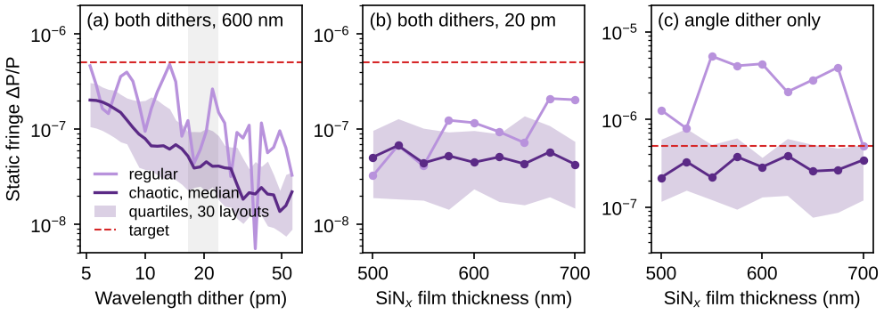

# QUIET simulations

Ray-tracing and speckle engine for chaotic multipass cells (PlanarEngine, GasEngine, DitherLab; JavaScript, Node ≥ 18)
with membrane loss, extended for the QUIET proposal: free-standing SiNx membrane cells, TM0 only. Python (numpy,
scipy, pytest) for the slab-mode and trench-DBR calculators, the metrics and the noise budget. Every script runs from
the command line and writes JSON to `results/`; `python -m pytest -q tests` checks the baselines and the extensions.

| Path | Content |
|---|---|
| `engine/quiet_engine.js` | working engine (Fig. 2 copy) with the QUIET extensions; `engine/original/` the two engines as received |
| `scripts/ens.js`, `scripts/ens2.js` | Fig. 3 / Fig. 2 ensembles (same CLI as the originals in `scripts/original/`; `--engine quiet|fig2|lab`) |
| `scripts/cells.js` | shared cell settings (Fig. 2 settings, n_eff, loss, R or R(sin χ), launch m) |
| `scripts/angle_hist.js` | distribution of \|sin χ\| over the bounces of the detected light |
| `scripts/step*.py` | the steps of the QUIET plan (below) |
| `qs/` | Python helpers: metrics, mirror reflectivity, gas absorption, noise budget |
| `design_calcs/slab.py`, `design_calcs/tmm.py` | free-standing slab TM0/TE0 n_eff and Γ; trench DBR transfer matrix |
| `results/baseline/` | the ensembles as received; `results/stepN*` the outputs of each step |

Settings of the baseline: circle 4 mm, 24 facets, 16 inclusions (Δn 0.01, radius 50 µm), launch 7.5° from the wall
normal, eps 1e-6, ±2 mrad angle dither, ±20 pm wavelength dither, 1 mW, Γ 0.2, R 0.99, 0.1 dB/cm.

## Step 0: baselines

`node scripts/ens2.js 0.99 0.1 circle 30 results/step0/f2_circle_0.99.json`,
`node scripts/ens.js 0.99 0.1 21 results/step0/ens_tgt.json`, then `python scripts/step0_baseline.py`
(→ `results/step0_baseline.json`). The repo engine reproduces the stored layouts bit for bit:

| Quantity | Quoted | Stored ensembles | Rerun |
|---|---|---|---|
| static fringe, both dithers, chaotic median (30 layouts) | 4.2e-8 | 4.16e-8 | 4.16e-8 |
| same, regular cell | 1.7e-7 | 1.66e-7 | 1.66e-7 |
| Γ⟨L⟩ | 2.5 cm | 2.53 cm | 2.53 cm |
| NH3 limit at 1 s (21 layouts) | 110 ppb | 110 ppb | 110 ppb |
| Si 250 nm TM0 at 1.55 µm: n_eff, Γ | 2.0, 0.64 | — | 2.015, 0.639 |

Definitions (`qs/metrics.py`): static fringe V_det = 2√eps · V / √grains (V the static floor of the dither mode, grains
the M² speckle grains of the detected light); NH3 limit = NEA / (α Γ⟨L⟩) with NEA = √(q/(P T_cell)/τ + r(τ)²), r(τ)
the fringe residual after averaging τ (drift 0.1 rad/s), medians over the layouts, and α = 2.27e-7 /cm/ppm, the
breath-broadened NH3 peak of the Fig. 3 HITRAN strips.

## Step 1: angle-dependent mirror reflectivity

The engine takes an optional `R_table: {s, R}` (R against |sin χ|, χ from the wall normal); every bounce before the exit
multiplies the ray's power by R(|sin χ|) (ensemble, fringe spectrum, speckle beamlets); without a table it uses the
constant `R_mirror` with unchanged arithmetic (a flat table reproduces it to 1e-15, `scripts/check_rtable.js`).

`qs/mirror.py`: effective-index trench DBR (vectorised `design_calcs/tmm.py`, s-polarisation for the TM0 slab mode,
gaps of index 1, teeth of index n_eff, air behind), total internal reflection above the critical angle included
(evanescent gaps; frustrated TIR if the membrane continues behind), optional sidewall roughness R·exp(−(4π n_eff σ
cos χ/λ)²) and an optional vertical-diffraction estimate. `node scripts/angle_hist.js --cell circle|herriott` gives the
|sin χ| distribution of the bounces of the detected light (8 layouts); `python scripts/step1_mirrors.py` optimises the
design (N ≤ 20 periods, odd quarter-wave gap and tooth orders 1/3/5, design angle, linear chirp ±0.2, two-band) for
the largest bounce-averaged R over that distribution and writes `results/step1_mirrors.json` and the R tables
`results/step1/Rtable_<cell>_neff<n>.json` (and `_rough5nm` versions). `python scripts/report.py step1` prints:

circle: bounce-averaged R vs N (optimised design per N)

| n_eff (film) | above crit. | N=1 | N=2 | N=4 | N=6 | N=8 | N=12 | N=20 | best design (N=20) | σ=5 nm | σ=10 nm | diffraction bound |
|---|---|---|---|---|---|---|---|---|---|---|---|---|
| 1.36 (400 nm @ 1.55 µm) | 12.6 % | 0.3503 | 0.5333 | 0.7641 | 0.8652 | 0.9109 | 0.9514 | 0.9932 | m 1/1, gap 505 nm, tooth 321 nm, 2-band, chirp +0.2 | 0.9907 | 0.9835 | 0.50 |
| 1.53 (500 nm @ 1.55 µm) | 16.3 % | 0.5085 | 0.7380 | 0.9158 | 0.9701 | 0.9854 | 0.9954 | 0.9998 | m 1/1, gap 466 nm, tooth 271 nm, 2-band, chirp +0.2 | 0.9967 | 0.9874 | 0.61 |
| 1.66 (600 nm @ 1.55 µm) | 20.2 % | 0.6072 | 0.8317 | 0.9737 | 0.9940 | 0.9985 | 0.9998 | 1.0000 | m 1/1, gap 428 nm, tooth 241 nm, 2-band, chirp +0.2 | 0.9963 | 0.9855 | 0.65 |
| 1.74 (700 nm @ 1.55 µm) | 22.8 % | 0.6571 | 0.8701 | 0.9853 | 0.9983 | 0.9997 | 1.0000 | 1.0000 | m 1/1, gap 456 nm, tooth 234 nm | 0.9960 | 0.9841 | 0.69 |
| 1.46 (1000 nm @ 3.30 µm) | 14.3 % | 0.4456 | 0.6644 | 0.8675 | 0.9374 | 0.9630 | 0.9884 | 0.9987 | m 1/1, gap 1075 nm, tooth 624 nm, 2-band, chirp +0.2 | 0.9981 | 0.9962 | 0.58 |
| 1.59 (1200 nm @ 3.30 µm) | 18.1 % | 0.5571 | 0.7873 | 0.9509 | 0.9842 | 0.9953 | 0.9991 | 0.9999 | m 1/1, gap 902 nm, tooth 535 nm, 2-band, chirp +0.2 | 0.9992 | 0.9969 | 0.64 |
| 1.71 (1500 nm @ 3.30 µm) | 21.8 % | 0.6393 | 0.8570 | 0.9820 | 0.9972 | 0.9995 | 1.0000 | 1.0000 | m 1/1, gap 971 nm, tooth 507 nm | 0.9991 | 0.9966 | 0.68 |

herriott: bounce-averaged R vs N (optimised design per N)

| n_eff (film) | above crit. | N=1 | N=2 | N=4 | N=6 | N=8 | N=12 | N=20 | best design (N=20) | σ=5 nm | σ=10 nm | diffraction bound |
|---|---|---|---|---|---|---|---|---|---|---|---|---|
| 1.36 (400 nm @ 1.55 µm) | 33.2 % | 0.4643 | 0.6174 | 0.8502 | 0.9453 | 0.9763 | 0.9906 | 0.9945 | m 1/1, gap 505 nm, tooth 321 nm, 2-band, chirp +0.2 | 0.9925 | 0.9864 | 0.66 |
| 1.53 (500 nm @ 1.55 µm) | 33.7 % | 0.5587 | 0.7575 | 0.9454 | 0.9871 | 0.9958 | 0.9992 | 0.9998 | m 1/1, gap 428 nm, tooth 263 nm, 2-band, chirp +0.2 | 0.9972 | 0.9895 | 0.73 |
| 1.66 (600 nm @ 1.55 µm) | 33.9 % | 0.6238 | 0.8299 | 0.9740 | 0.9959 | 0.9991 | 0.9999 | 1.0000 | m 1/1, gap 423 nm, tooth 240 nm, 2-band, chirp +0.1 | 0.9969 | 0.9878 | 0.74 |
| 1.74 (700 nm @ 1.55 µm) | 34.0 % | 0.6599 | 0.8628 | 0.9837 | 0.9980 | 0.9997 | 1.0000 | 1.0000 | m 1/1, gap 427 nm, tooth 230 nm, chirp +0.2 | 0.9966 | 0.9866 | 0.76 |
| 1.46 (1000 nm @ 3.30 µm) | 33.5 % | 0.5207 | 0.7062 | 0.9177 | 0.9764 | 0.9910 | 0.9971 | 0.9991 | m 1/1, gap 973 nm, tooth 604 nm, 2-band, chirp +0.2 | 0.9986 | 0.9970 | 0.72 |
| 1.59 (1200 nm @ 3.30 µm) | 33.8 % | 0.5897 | 0.7941 | 0.9612 | 0.9925 | 0.9978 | 0.9997 | 1.0000 | m 1/1, gap 923 nm, tooth 540 nm, 2-band, chirp +0.2 | 0.9993 | 0.9975 | 0.74 |
| 1.71 (1500 nm @ 3.30 µm) | 34.0 % | 0.6468 | 0.8514 | 0.9807 | 0.9973 | 0.9995 | 1.0000 | 1.0000 | m 1/1, gap 971 nm, tooth 507 nm | 0.9993 | 0.9971 | 0.76 |

Findings: the first-order design (gap and tooth both λ/4 at the design angle) wins everywhere, usually with two bands
and the largest chirp tried; R grows fast with N for n_eff ≥ 1.53 (≥ 0.999 from N ≈ 8–12) while n_eff 1.36 stays at
0.993 (circle) / 0.995 (Herriott) at N = 20, its low index contrast cannot cover all sub-critical angles. 13–23 % of
the circle's bounces (34 % in the Herriott, its side walls) are above the critical angle and reflect totally.
Sidewall roughness of 5 nm rms caps the bounce average at 0.996–0.997 at 1.55 µm (0.998–0.999 at 3.3 µm), 10 nm at
≈ 0.985.

Vertical diffraction (limitation, estimated): the membrane TM0 modes are only ≈ λ/5 wide (rms of the power flux), so
a free-standing λ/4 air gap couples just 77–81 % of the power back into the next tooth (exact scalar angular-spectrum
propagation, `qs/mirror.gap_coupling`). Charging every gap traversal independently would cut the bounce average to
0.5–0.76 (column "diffraction bound"); that bound is far too pessimistic for a first-order mirror, whose period
(≈ 0.4 λ < λ/2) puts the stop-band Bloch mode below the light line so it does not radiate inside the mirror; the real
loss sits at the slab-to-mirror transition and needs a vertical 2D (FDTD / mode-matching) calculation, ideally with an
adiabatic taper of the first periods. The ensembles below use the in-plane R tables (no diffraction term).

## Step 2: ensembles with R(χ) and 0.1 dB/cm

`bash scripts/run_step2.sh` (→ `results/step2/`, `node scripts/ensemble.js`, 30 layouts + the regular cell per case,
R tables of step 1, SiNx n_eff at 1.55 µm, 0.1 dB/cm, circle CMPC and Herriott cell with the Fig. 2 settings) and
`python scripts/step2_ensembles.py` (→ `results/step2_summary.json`); `python scripts/report.py step2`:

| cell | film (n_eff, Γ) | R(χ) | static fringe: none / spectral / angle / both (chaotic median) | both, regular | layouts < 5e-7 | Γ⟨L⟩ | T | ⟨R⟩ bounce | NH3 1 s |
|---|---|---|---|---|---|---|---|---|---|
| circle (baseline) | Si 250 nm (2.0, 0.20) | R 0.99 | 1.2e-04 / 4.5e-06 / 4.5e-07 / 4.2e-08 | 1.7e-07 | 97 % | 2.53 cm | 0.23 | 0.99 | 110 ppb |
| circle | SiNx 400 nm (1.36, 0.67) | R(χ) | 1.4e-04 / 5.3e-06 / 2.5e-07 / 5.5e-08 | 4.3e-08 | 100 % | 8.34 cm | 0.28 | 0.9931 | 41 ppb |
| circle | SiNx 500 nm (1.53, 0.46) | R(χ) | 1.3e-04 / 5.4e-06 / 2.9e-07 / 4.6e-08 | 7.7e-08 | 93 % | 6.63 cm | 0.35 | 0.9998 | 36 ppb |
| circle | SiNx 600 nm (1.66, 0.31) | R(χ) | 1.3e-04 / 5.4e-06 / 2.6e-07 / 3.4e-08 | 4.0e-08 | 100 % | 4.67 cm | 0.34 | 1.0000 | 34 ppb |
| circle | SiNx 600 nm (1.66, 0.31) | R(χ), σ 5 nm | 1.3e-04 / 5.4e-06 / 2.8e-07 / 3.7e-08 | 4.4e-08 | 97 % | 4.36 cm | 0.30 | 0.9963 | 40 ppb |
| circle | SiNx 700 nm (1.74, 0.21) | R(χ) | 1.2e-04 / 3.4e-06 / 2.5e-07 / 5.5e-08 | 1.7e-07 | 100 % | 3.13 cm | 0.34 | 1.0000 | 71 ppb |
| herriott | SiNx 400 nm (1.36, 0.67) | R(χ) | 2.2e-04 / 1.0e-05 / 3.1e-06 / 3.8e-07 | 6.8e-05 | 67 % | 10.23 cm | 0.56 | 0.9946 | 179 ppb |
| herriott | SiNx 500 nm (1.53, 0.46) | R(χ) | 2.2e-04 / 7.9e-06 / 3.2e-06 / 3.8e-07 | 8.3e-05 | 60 % | 7.79 cm | 0.63 | 0.9999 | 180 ppb |
| herriott | SiNx 600 nm (1.66, 0.31) | R(χ) | 2.2e-04 / 6.0e-06 / 3.0e-06 / 2.1e-07 | 7.7e-05 | 67 % | 5.64 cm | 0.61 | 1.0000 | 148 ppb |
| herriott | SiNx 600 nm (1.66, 0.31) | R(χ), σ 5 nm | 2.2e-04 / 6.5e-06 / 3.3e-06 / 2.3e-07 | 7.7e-05 | 70 % | 5.34 cm | 0.56 | 0.9969 | 182 ppb |
| herriott | SiNx 700 nm (1.74, 0.21) | R(χ) | 2.1e-04 / 5.2e-06 / 3.2e-06 / 2.2e-07 | 1.9e-04 | 70 % | 4.10 cm | 0.59 | 1.0000 | 179 ppb |

Static fringe: V_det = 2√eps·V/√grains for each dither mode (V = 1 without dither); medians over 30 layouts. Γ⟨L⟩ with
the Γ of each film (slab solver: 0.67, 0.46, 0.31, 0.22). NH3 limit at 1 s from the medians of the first 21 layouts
as in the baseline; the noise-equivalent absorbance does not depend on Γ, so ppb scales as 1/(Γ⟨L⟩).

Findings: with the step-1 mirrors the circular SiNx cells beat the Si baseline by about 3× (34–41 ppb against 110):
higher Γ, near-unity mirrors (T 0.28–0.35 against 0.23) and a static fringe that stays at 3–6e-8 with both dithers,
all or nearly all layouts below 5e-7. 600 nm (n_eff 1.66) is the best compromise; 400 nm has the largest Γ⟨L⟩ but its
mirror (⟨R⟩ 0.993) costs transmission; 700 nm loses on Γ. 5 nm sidewall roughness costs ≈ 15 % (34 → 40 ppb). The
Herriott cell keeps more light (T ≈ 0.6) and a long path but its fringe is 5–10× worse (2–4e-7 with both dithers,
regular 1e-4) and only 60–70 % of the layouts reach 5e-7: 150–180 ppb.

## Step 3: launch-angle study

`bash scripts/run_step3.sh` (per launch and n_eff: bounce-angle histogram → N = 20 mirror optimised for it with
`scripts/make_rtable.py` → 21 layouts + regular) and `python scripts/step3_launch.py` (→ `results/step3_summary.json`,
with bootstrap 68 % intervals of the NH3 limit over the layouts); `python scripts/report.py step3`:

| n_eff | m | χ | passes to exit (regular) | bounces above critical | ⟨R⟩ bounce (N=20 mirror) | Γ⟨L⟩ | T | static fringe both (chaotic / regular) | NH3 1 s [68 % CI] |
|---|---|---|---|---|---|---|---|---|---|
| 1.66 | 11 | 7.5° | 23 | 19 % | 1.0000 | 4.70 cm | 0.35 | 4.6e-08 / 1.2e-07 | 48 ppb [38–69] |
| 1.66 | 8 | 30.0° | 2 | 24 % | 1.0000 | 0.47 cm | 0.90 | 2.4e-05 / 3.2e-05 | 221862 ppb [193765–343485] |
| 1.66 | 5 | 52.5° | 23 | 65 % | 1.0000 | 3.21 cm | 0.39 | 4.4e-08 / 8.1e-08 | 66 ppb [51–85] |
| 1.66 | 2 | 75.0° | 11 | 89 % | 1.0000 | 1.82 cm | 0.60 | 4.7e-07 / 1.0e-06 | 1127 ppb [988–1210] |
| 1.66 | 1 | 82.5° | 23 | 93 % | 1.0000 | 1.80 cm | 0.54 | 8.9e-08 / 6.6e-07 | 221 ppb [211–286] |
| 1.36 | 11 | 7.5° | 23 | 12 % | 0.9931 | 8.33 cm | 0.29 | 5.8e-08 / 5.3e-08 | 33 ppb [31–53] |
| 1.36 | 8 | 30.0° | 2 | 7 % | 0.9919 | 0.58 cm | 0.83 | 4.1e-05 / 1.6e-04 | 310785 ppb [272457–384756] |
| 1.36 | 5 | 52.5° | 23 | 55 % | 0.9974 | 6.35 cm | 0.33 | 2.0e-07 / 1.6e-07 | 138 ppb [90–163] |
| 1.36 | 2 | 75.0° | 11 | 92 % | 0.9988 | 2.56 cm | 0.53 | 5.3e-07 / 6.6e-07 | 911 ppb [820–943] |
| 1.36 | 1 | 82.5° | 23 | 91 % | 0.9994 | 3.82 cm | 0.50 | 1.7e-07 / 8.4e-07 | 199 ppb [182–272] |

Star orbit with step 24 − m facets: the exit facet m is reached after k passes with (24 − m)·k ≡ m (mod 24). Every
odd m (11, 5, 1) needs all 23 passes, but m = 8 closes a triangle and exits after 2 chords (Γ⟨L⟩ 0.5 cm, the fringe is
not scrambled) and m = 2 a 12-gon that exits after 11. For m = 2 and 1 the rays live in an annulus between the caustic
a·sin χ and the wall thinner than a 50 µm inclusion, so the inclusions are placed anywhere in the cell (inc_ring 0)
and the rays rarely meet them.

Decision for SiNx: keep the 7.5° launch (m = 11). It gives the longest Γ⟨L⟩ and the lowest fringe (NH3 33–48 ppb).
Grazing launches buy total internal reflection (89–93 % of the bounces at 75–82.5°, R ≈ 1 without a mirror) but
shorten the path to 2–4 cm Γ⟨L⟩ and leave the inclusions behind (fringe 1–5e-7): 200 ppb and worse. 52.5° (m = 5) is
the fall-back if the trench mirrors underperform: 55–65 % of its bounces reflect totally, so a sub-critical mirror
reflectivity R_s enters as ⟨R⟩ ≈ 0.35 R_s + 0.65 (m = 5, n_eff 1.66) against 0.81 R_s + 0.19 (m = 11): with R_s =
0.98, 0.993 against 0.984 per bounce. It costs ≈ 1.4× in NH3 (66 ppb) with ideal mirrors.

## Step 4: mid-infrared (3.3 µm) SiNx cells and HITRAN line strengths

`python scripts/step4_gas.py` (→ `results/step4_gas.json`): HAPI 1.3 run offline on the HITRAN line files in
`../HITRAN/hitran_data` (hitran.org itself is not reachable from the simulation host; these are the files
`HITRAN/get_spectra.py` fetched), 1 ppm analyte in breath: 1 atm, 35 °C, H2O at saturation (5.5 %), CO2 4.5 %, Voigt
with air broadening, line-resolved strips of ±1.5 /cm with the H2O and CO2 background. On the Fig. 3 lines HAPI
reproduces the Fig. 3 strips to 1 %.

| analyte | strongest line near target | α peak, 1 ppm (/cm) | H2O / CO2 background there (/cm) | Fig. 3 line: α (HAPI / Fig. 3 data) |
|---|---|---|---|---|
| CH4_3.31 | 3016.492 /cm (3.3151 µm) | 3.794e-05 | 2.4e-05 / 2.6e-10 | 3017.800 /cm: 3.647e-05 / 3.614e-05 |
| CH4_1.65 | 6057.084 /cm (1.6510 µm) | 4.335e-07 | 1.2e-08 / 1.3e-07 | 6114.652 /cm: 1.542e-07 / 1.548e-07 |
| C2H6_3.34 | 2986.682 /cm (3.3482 µm) | 3.691e-05 | 1.5e-05 / 1.5e-10 | 2996.852 /cm: 3.344e-05 / 3.317e-05 |
| NH3_1.53 | 6528.774 /cm (1.5317 µm) | 2.276e-07 | 1.8e-07 / 8.1e-07 | 6528.774 /cm: 2.276e-07 / 2.266e-07 |

CH4 3.31 / 1.65 µm peak ratio: 88× (strongest lines), 237× (Fig. 3 lines).

The crude 150–230× line-strength scaling is replaced by the HITRAN peaks: 88× between the strongest CH4 lines at 3.31
and 1.65 µm, 237× between the two Fig. 3 lines. At 3.31 µm the breath water absorbs 2.4e-5 /cm under the CH4 peak
(as much as 0.6 ppm CH4), and at the 1.53 µm NH3 line CO2 absorbs 8e-7 /cm: the lines need spectral fitting against
that background; the limits below use the peak absorption of the analyte alone.

`bash scripts/run_step4.sh` (circle and Herriott, films 1.0 / 1.2 / 1.5 µm with n_eff 1.46 / 1.59 / 1.71 and Γ 0.53 /
0.37 / 0.22 from `design_calcs/slab.py` with n = 1.97, R tables of step 1, membrane loss 0.1 / 0.3 / 0.5 dB/cm,
λ = 3.3151 µm, the same ±2 mrad and ±20 pm dithers, 21 layouts) and `python scripts/step4_midir.py`
(→ `results/step4_summary.json`): detection limits at 1 s (1 mW, shot noise √(q/(P T)) and the fringe residual) and
the averaging time to reach 10 ppb and 1 ppb (median noise curve over the layouts, up to 100 s):

| cell | film (n_eff, Γ) | loss | Γ⟨L⟩ | T | ⟨R⟩ | CH4 1 s | CH4 τ(10 ppb) / τ(1 ppb) | C2H6 1 s | C2H6 τ(10 ppb) / τ(1 ppb) |
|---|---|---|---|---|---|---|---|---|---|
| circle | 1.0 µm (1.46, 0.53) | 0.1 dB/cm | 7.48 cm | 0.35 | 0.9988 | 2.3 ppb | 0.15 ms / 30 s | 2.4 ppb | 0.16 ms / 31 s |
| circle | 1.0 µm (1.46, 0.53) | 0.3 dB/cm | 5.57 cm | 0.20 | 0.9987 | 4.7 ppb | 0.38 ms / 64 s | 4.8 ppb | 0.4 ms / 66 s |
| circle | 1.0 µm (1.46, 0.53) | 0.5 dB/cm | 4.54 cm | 0.13 | 0.9986 | 7.3 ppb | 1.1 ms / not within 100 s | 7.6 ppb | 1.2 ms / not within 100 s |
| circle | 1.2 µm (1.59, 0.37) | 0.1 dB/cm | 4.99 cm | 0.36 | 0.9999 | 1.5 ppb | 0.25 ms / 16 s | 1.6 ppb | 0.26 ms / 17 s |
| circle | 1.2 µm (1.59, 0.37) | 0.3 dB/cm | 3.70 cm | 0.20 | 0.9999 | 3.1 ppb | 0.59 ms / 42 s | 3.2 ppb | 0.62 ms / 43 s |
| circle | 1.2 µm (1.59, 0.37) | 0.5 dB/cm | 2.95 cm | 0.14 | 0.9999 | 5.4 ppb | 1.5 ms / 75 s | 5.5 ppb | 1.6 ms / 77 s |
| circle | 1.5 µm (1.71, 0.22) | 0.1 dB/cm | 3.20 cm | 0.36 | 1.0000 | 2.0 ppb | 0.65 ms / 25 s | 2.1 ppb | 0.69 ms / 26 s |
| circle | 1.5 µm (1.71, 0.22) | 0.3 dB/cm | 2.37 cm | 0.20 | 1.0000 | 4.0 ppb | 1.5 ms / 54 s | 4.1 ppb | 1.6 ms / 56 s |
| circle | 1.5 µm (1.71, 0.22) | 0.5 dB/cm | 1.88 cm | 0.12 | 1.0000 | 6.6 ppb | 4.8 ms / 93 s | 6.8 ppb | 5.3 ms / 95 s |
| herriott | 1.0 µm (1.46, 0.53) | 0.1 dB/cm | 6.99 cm | 0.70 | 0.9991 | 21.0 ppb | 26 s / not within 100 s | 21.5 ppb | 27 s / not within 100 s |
| herriott | 1.0 µm (1.46, 0.53) | 0.3 dB/cm | 5.22 cm | 0.41 | 0.9990 | 34.5 ppb | 47 s / not within 100 s | 35.5 ppb | 48 s / not within 100 s |
| herriott | 1.0 µm (1.46, 0.53) | 0.5 dB/cm | 3.33 cm | 0.37 | 0.9990 | 236.8 ppb | not within 100 s / not within 100 s | 243.4 ppb | not within 100 s / not within 100 s |
| herriott | 1.2 µm (1.59, 0.37) | 0.1 dB/cm | 5.39 cm | 0.69 | 1.0000 | 24.0 ppb | 31 s / not within 100 s | 24.7 ppb | 32 s / not within 100 s |
| herriott | 1.2 µm (1.59, 0.37) | 0.3 dB/cm | 4.06 cm | 0.38 | 1.0000 | 40.0 ppb | 55 s / not within 100 s | 41.2 ppb | 57 s / not within 100 s |
| herriott | 1.2 µm (1.59, 0.37) | 0.5 dB/cm | 2.28 cm | 0.37 | 1.0000 | 222.0 ppb | not within 100 s / not within 100 s | 228.2 ppb | not within 100 s / not within 100 s |
| herriott | 1.5 µm (1.71, 0.22) | 0.1 dB/cm | 3.30 cm | 0.68 | 1.0000 | 25.1 ppb | 33 s / not within 100 s | 25.8 ppb | 34 s / not within 100 s |
| herriott | 1.5 µm (1.71, 0.22) | 0.3 dB/cm | 2.40 cm | 0.38 | 1.0000 | 57.7 ppb | 81 s / not within 100 s | 59.3 ppb | 83 s / not within 100 s |
| herriott | 1.5 µm (1.71, 0.22) | 0.5 dB/cm | 1.40 cm | 0.36 | 1.0000 | 654.6 ppb | not within 100 s / not within 100 s | 672.9 ppb | not within 100 s / not within 100 s |

Findings: the circular CMPC reaches 1.5–7 ppb CH4 and C2H6 at 1 s for every film and loss, 10 ppb within
milliseconds and 1 ppb within 16–95 s (not within 100 s for the 1.0 µm film at 0.5 dB/cm). The 1.2 µm film is
best (Γ 0.37 with a near-perfect mirror). The loss sets the transmission and path: 0.1 → 0.5 dB/cm costs 2.3–3.3×.
The Herriott cell is fringe-limited at 3.3 µm. Its static fringe is 3–6e-6 (2e-7 at 1.55 µm): the inclusions' phase
kicks (∝ Δn r/λ) halve, ±20 pm is a smaller relative wavelength dither, and at 0.5 dB/cm the shorter path scrambles
even less (2–4e-5). That gives 21–58 ppb at 1 s up to 0.3 dB/cm and 220–650 ppb at 0.5 dB/cm; 1 ppb is never reached.
A larger wavelength dither (scaled with λ²) would be the first thing to try for a mid-IR Herriott cell.

## Step 5: noise budget (detector noise and insertion loss)

`python scripts/step5_noise.py` (→ `results/step5_noise.json`, `qs/noise.py`): P_det = P_in·10^(−IL/10),
NEA(τ) = √((q/P_det + (NEP/P_det)²)/τ + r(τ)²) with responsivity 1 A/W, the shot term as in the baseline, and
r(τ) and Γ⟨L⟩ from the step-4 cell with the lowest CH4 limit at 0.3 dB/cm (circle 1.2 µm; the Herriott 1.0 µm case is
also in the JSON). The insertion loss replaces the ensemble transmission (it includes coupling). The NEA curves vs τ
are in the JSON (`nea_tau_grid_s`, `fringe_residual_curve`). M7 table (10 ppb, margin = 10 ppb / limit at 1 s):

circle_neff1.59_0.3dB (Γ⟨L⟩ 3.70 cm, fringe residual at 1 s 4.4e-07):

| P_in | IL | NEP (W/√Hz) | P_det | CH4 1 s / 10 s | C2H6 1 s / 10 s | M7 margin (10 ppb, 1 s) CH4 / C2H6 | 10 ppb at 1 s / 10 s | 1 ppb at 1 s / 10 s |
|---|---|---|---|---|---|---|---|---|
| 0.1 mW | 20 dB | 1e-12 | 1.0e-06 W | 8.3 / 3.5 ppb | 8.5 / 3.6 ppb | 1.21× / 1.18× | yes / yes | no / no |
| 0.1 mW | 20 dB | 1e-11 | 1.0e-06 W | 71.3 / 22.7 ppb | 73.3 / 23.3 ppb | 0.14× / 0.14× | no / no | no / no |
| 0.1 mW | 20 dB | 1e-10 | 1.0e-06 W | 711.5 / 225.0 ppb | 731.4 / 231.3 ppb | 0.01× / 0.01× | no / no | no / no |
| 0.1 mW | 35 dB | 1e-12 | 3.2e-08 W | 225.6 / 71.4 ppb | 231.9 / 73.4 ppb | 0.04× / 0.04× | no / no | no / no |
| 0.1 mW | 35 dB | 1e-11 | 3.2e-08 W | 2250.0 / 711.5 ppb | 2312.9 / 731.4 ppb | 0.00× / 0.00× | no / no | no / no |
| 0.1 mW | 35 dB | 1e-10 | 3.2e-08 W | 22499.1 / 7114.8 ppb | 23128.1 / 7313.7 ppb | 0.00× / 0.00× | no / no | no / no |
| 1 mW | 20 dB | 1e-12 | 1.0e-05 W | 3.3 / 2.6 ppb | 3.4 / 2.6 ppb | 3.01× / 2.93× | yes / yes | no / no |
| 1 mW | 20 dB | 1e-11 | 1.0e-05 W | 7.8 / 3.4 ppb | 8.0 / 3.5 ppb | 1.28× / 1.24× | yes / yes | no / no |
| 1 mW | 20 dB | 1e-10 | 1.0e-05 W | 71.2 / 22.6 ppb | 73.2 / 23.3 ppb | 0.14× / 0.14× | no / no | no / no |
| 1 mW | 35 dB | 1e-12 | 3.2e-07 W | 23.3 / 7.7 ppb | 23.9 / 7.9 ppb | 0.43× / 0.42× | no / yes | no / no |
| 1 mW | 35 dB | 1e-11 | 3.2e-07 W | 225.1 / 71.2 ppb | 231.4 / 73.2 ppb | 0.04× / 0.04× | no / no | no / no |
| 1 mW | 35 dB | 1e-10 | 3.2e-07 W | 2249.9 / 711.5 ppb | 2312.8 / 731.4 ppb | 0.00× / 0.00× | no / no | no / no |
| 10 mW | 20 dB | 1e-12 | 1.0e-04 W | 3.1 / 2.6 ppb | 3.2 / 2.6 ppb | 3.19× / 3.11× | yes / yes | no / no |
| 10 mW | 20 dB | 1e-11 | 1.0e-04 W | 3.2 / 2.6 ppb | 3.3 / 2.6 ppb | 3.11× / 3.03× | yes / yes | no / no |
| 10 mW | 20 dB | 1e-10 | 1.0e-04 W | 7.8 / 3.4 ppb | 8.0 / 3.5 ppb | 1.29× / 1.25× | yes / yes | no / no |
| 10 mW | 35 dB | 1e-12 | 3.2e-06 W | 4.2 / 2.7 ppb | 4.3 / 2.8 ppb | 2.40× / 2.34× | yes / yes | no / no |
| 10 mW | 35 dB | 1e-11 | 3.2e-06 W | 22.8 / 7.6 ppb | 23.4 / 7.8 ppb | 0.44× / 0.43× | no / yes | no / no |
| 10 mW | 35 dB | 1e-10 | 3.2e-06 W | 225.0 / 71.2 ppb | 231.3 / 73.2 ppb | 0.04× / 0.04× | no / no | no / no |

Meets 10 ppb at 1 s (CH4 and C2H6), circular SiNx cell: at 20 dB with NEP 1e-12 for every power, with 1e-11 from
1 mW, with 1e-10 only at 10 mW (margins 1.2–3.2×); at 35 dB only 10 mW with NEP 1e-12 (2.4×). At 10 s also 1 mW /
35 dB / 1e-12 and 10 mW / 35 dB / 1e-11. 1 ppb is met by no combination at 1 s or 10 s: the fringe residual
(4.4e-7 at 1 s) sets a floor of ≈ 2.6–3.1 ppb, which only falls below 1 ppb after ≈ 40 s of averaging (step 4). The
Herriott cell is fringe-limited at ≈ 28–35 ppb whatever the detector and power: it meets neither target.

## Summary

| Step | Result |
|---|---|
| 0 baselines | reproduced bit for bit: fringe both dithers 4.16e-8 chaotic / 1.66e-7 regular, Γ⟨L⟩ 2.53 cm, NH3 110 ppb at 1 s, Si 250 nm TM0 n_eff 2.015, Γ 0.639 |
| 1 mirrors R(χ) | first-order trench DBR, N = 20: bounce-averaged R 0.993 (n_eff 1.36), 0.9998 (1.53), ≈ 1.0000 (1.66, 1.74); 13–23 % of the circle's bounces (34 % Herriott) totally reflected; 5 nm roughness → 0.996; vertical diffraction is the open risk (isolated-gap bound 0.5–0.76, needs 2D FDTD) |
| 2 ensembles 1.55 µm | circle SiNx 34–41 ppb NH3 (600 nm best: 34 ppb, Γ⟨L⟩ 4.7 cm, T 0.34), fringe 3–6e-8, ≥ 93 % layouts < 5e-7; Herriott 150–180 ppb, fringe 2–4e-7, 60–70 % < 5e-7 |
| 3 launch | keep 7.5° (m = 11): 33–48 ppb; grazing launches are 89–93 % TIR but short and unscrambled (200–1100 ppb); 52.5° is the fall-back for weak mirrors (66 ppb) |
| 4 mid-IR | HITRAN peaks: CH4 3.31 µm 3.79e-5, C2H6 3.35 µm 3.69e-5, CH4 1.65 µm 4.3e-7, NH3 1.53 µm 2.28e-7 /cm/ppm (88–237× CH4 gain); circle CH4/C2H6 1.5–7 ppb at 1 s, 1 ppb in 16–95 s (1.2 µm film best); Herriott fringe-limited |
| 5 noise budget | 10 ppb at 1 s: 20 dB IL with NEP ≤ 1e-11 from 1 mW (≤ 1e-10 at 10 mW), 35 dB only at 10 mW with NEP 1e-12; 1 ppb at ≤ 10 s: none (fringe floor ≈ 3 ppb) |

Limitations: 2D ray optics with an effective index; vertical diffraction in the mirror gaps not in R(χ) (estimated
separately); the limits use the analyte's peak absorption without fitting the H2O / CO2 background; the
ensemble-to-ensemble scatter of a median over 21–30 chaotic layouts is tens of per cent (bootstrap intervals in the
step-3 and step-2 summaries); mid-IR runs keep the 1.55 µm dither settings (±2 mrad, ±20 pm).

## Step 6: DFG source design (MgO:PPLN)

`python scripts/step6_dfg.py` (→ `results/step6_dfg.json`, `results/step6_period_grid.csv`; model and literature
parameters in `qs/dfg.py`, each marked LIT / VERIFY / ASSUMPTION). Pump 1064.0 nm, type-0 (eee) QPM along x.

| line | idler | signal | period (write at 25 °C, QPM at 60 °C) | T acceptance 20 / 50 mm | signal acceptance 20 / 50 mm | P_idler (1 W pump, 5 W signal) 20 / 50 mm |
|---|---|---|---|---|---|---|
| CH4 3016.49 /cm (strongest, step 4) | 3.3151 µm | 1566.9 nm | 30.66 µm | 10.1 / 4.1 °C | 4.2 / 1.7 nm (510 / 204 GHz) | 14–18 / 36–45 mW |
| CH4 3.31 µm (brief) | 3.3100 µm | 1568.1 nm | 30.67 µm | 10.1 / 4.1 °C | 4.2 / 1.7 nm | 14–18 / 36–45 mW |
| C2H6 2996.85 /cm (Q-branch, brief 3.34 µm) | 3.3368 µm | 1562.1 nm | 30.61 µm | 10.1 / 4.1 °C | 4.0 / 1.6 nm | 14–18 / 36–44 mW |
| C2H6 2986.68 /cm (strongest, step 4) | 3.3482 µm | 1559.6 nm | 30.58 µm | 10.1 / 4.1 °C | 4.0 / 1.6 nm | 14–18 / 35–44 mW |

Idler 3.06–3.66 µm needs periods 29.2–31.3 µm over 25–200 °C (grid in the CSV); a multi-period chip with 0.2 µm steps
or a fan-out over that range covers it. Walk-off: none (eee along a principal axis). Power: Boyd–Kleinman,
d_eff = 14 pm/V, h = 0.8–1.0: 1.8 mW/(W² cm) at the theoretical optimum, P_i ∝ L P_p P_s (1 W signal: 7–9 mW at 50 mm);
experiments typically reach 30–60 % of it. Dither: ±20 pm at 3.31 µm = ±0.55 GHz, carried entirely by the signal with
a fixed pump: ±4.5 pm at 1.567 µm (or ±2.1 pm on the pump), < 1 % of the QPM acceptance; DFB current modulation
(≈ ±0.5–1 mA) reaches it at 1–100 kHz.

## Step 7: thermo-optic launch-angle dither

`python scripts/step7_thermo.py` (→ `results/step7_thermo.json`; model and parameters in the script docstring).
K beams fanned in across the 30 µm port aperture form a phased array; a linear phase ramp steers the launch by ±2 mrad.

| chip | n_eff | modes in port | edge phase | ΔT (200 µm heater) | P per edge heater, anchors 10 / 20 / 50 µm | f_3dB, anchors 10 / 20 / 50 µm |
|---|---|---|---|---|---|---|
| SiNx 600 nm, 1.55 µm (dn/dT 2.45e-5 /K) | 1.66 | 64 | ±0.20 rad | ±10 K | 0.60 / 0.30 / 0.12 mW | 4.5 / 1.1 / 0.18 kHz |
| SiNx 1.2 µm, 3.3 µm | 1.59 | 29 | ±0.09 rad | ±9.9 K | 1.19 / 0.59 / 0.24 mW | 4.5 / 1.1 / 0.18 kHz |
| Si 250 nm, 1.55 µm (1.8e-4 /K) | 2.02 | 78 | ±0.25 rad | ±1.3 K | 0.80 / 0.40 / 0.16 mW | 144 / 36 / 5.8 kHz |

The heater power does not depend on the heater length (P = 2κt·Δφλ/(2π ℓ dn_eff/dT)); it scales as 1/ℓ and the
time constant as ℓ² (ℓ: distance to the heat-sunk anchors). The 9× smaller dn/dT of SiNx is offset by its 24× lower
thermal conductivity in power, but its thermal diffusivity is ≈ 40× lower, so it is slow: SiNx needs anchors within
≈ 20 µm of the heater for a 1 kHz dither (≈ 0.3 mW per edge heater, 0.6 mW at 3.3 µm, × K/2 for the array plus the
same as bias), while Si reaches tens of kHz. One-second measurements are feasible: the fig. 3b averaging assumes a
1 kHz angle dither (hundreds of periods per second). Assumptions: LPCVD SiNx κ = 2.5 W/mK, Si film κ = 60 W/mK, the
same dn/dT at 3.3 µm, through-etched release (a 2 µm air gap below adds 0.26 mW per heater).

## Step 8: Fig. 1d data (SiNx only)

`python scripts/step8_fig1d.py` (→ `results/step8_fig1d.csv` with n_eff, n_g and both Γ for TE0 / TM0, 1.55 and
3.0 µm, n = 2.0 / 1.97 and the Luke et al. 2015 LPCVD Si3N4 dispersion (marked; coefficients to verify), 50–1500 nm;
`results/step8_fig1d.json`; `results/figs/fig1d_SiNx.pdf`, 15.5 cm, 10 pt, solid 1.55 µm / dashed 3.0 µm, TM0 navy,
TE0 light blue, design points as black dots). `qs/slabmodes.py` solves the fundamental mode robustly
(`design_calcs/slab.py` returns a higher-order mode once the film is multimode, e.g. 1500 nm at 1.55 µm).

Γ definition: the existing Fig. 1d plots the absorption confinement factor Γ_abs = n_g ∫_gas ε|E|² / ∫ε|E|²
(Robinson et al. 2008; it exceeds 1 for thin Si, e.g. 1.30 at 400 nm, 3.0 µm), while Steps 2–5 and the brief use the
|E|² fraction Γ_E. They agree for Si 250 nm (0.64) but not for SiNx:

| design point | n_eff (TM0) | n_g | Γ_E (steps 2–5) | Γ_abs (Fig. 1d) | Luke 2015 dispersion: n_eff, Γ_abs |
|---|---|---|---|---|---|
| SiNx 600 nm, 1.55 µm | 1.657 | 2.26 | 0.313 | 0.231 | 1.653, 0.237 |
| SiNx 1.2 µm, 3.3 µm | 1.588 | 2.23 | 0.372 | 0.296 | 1.554, 0.335 |
| SiNx 1.2 µm, 3.0 µm (dashed curve) | 1.646 | 2.21 | 0.300 | 0.220 | 1.624, 0.243 |

TE0 overlaps are 4–6× smaller (0.05–0.06 at the design points): TM0 is the right choice.

## Step 9: proposal figures from the new runs

`python scripts/step9_figures.py` (→ `results/figs/fig2f_static_fringe.pdf` (8.4 cm), `results/figs/fig3_spectroscopy.pdf`
(16.8 cm), `results/figs/fig1d_SiNx.pdf` (step 8), Liberation Sans 10 pt, the colours of the existing PDFs; plotted
numbers in `results/step9_figdata.json`). Medians and quartiles over the layouts; regular cells as single values.

* Fig. 2f, 600 nm SiNx cells with R(χ) and 0.1 dB/cm (30 layouts; none / spectral / angle / both):
  R-Herriott 8.7e-4 / 7.7e-5 / 8.7e-4 / 7.7e-5; C-Herriott 2.2e-4 / 6.0e-6 / 3.0e-6 / 2.1e-7;
  R-CMPC 2.3e-4 / 1.9e-5 / 3.4e-6 / 4.0e-8; C-CMPC 1.3e-4 / 5.4e-6 / 2.6e-7 / 3.4e-8; target 5e-7.
* Fig. 3b, 600 nm SiNx circle (21 layouts, min–max bands): NH3 35 ppb at 1 s (NEA 3.7e-8, Γ⟨L⟩ 4.7 cm with
  Γ_E = 0.31), replacing 52 ppb; shot-limited below ≈ 1 s, the angle-only curve flattens at ≈ 2e-7 and both dithers
  reach the shot line.
* Fig. 3a: the HITRAN strips with the new 1 s noise (NH3 10 ppm, CH4 / C2H6 1 ppm: concentrations inferred from the
  existing panel scales; mid-IR strips with the 1.2 µm / 0.3 dB/cm circle of step 4). The fringe pattern is an
  illustration (exponential exit-path statistics, random phases) whose rms is the median residual at 1 s.

## Step 10: spec cases for the Fig. 2 and Fig. 3 artifacts

`bash scripts/run_step10.sh` (→ `results/step10/<cell>_<case>.json`, 30 layouts + regular per case, 600 nm SiNx,
TM0, n_eff 1.66, Γ 0.313) and `python scripts/step10_specs.py` (→ `results/step10_summary.json`, table below):

- ideal: the designed 20-period R(χ) table of step 1, no membrane loss;
- target: the same mirror, 0.1 dB/cm (the step-2 ensemble, copied);
- minimum: R(χ) capped at 0.95 below the critical angle (sin χ < 1/n_eff; total internal reflection kept above it,
  `results/step1/Rtable_<cell>_neff1.66_min95.json`), 0.3 dB/cm.

| cell | spec | static fringe none / spectral / angle / both (chaotic median) | both: quartiles | both, regular | layouts < 5e-7 | Γ⟨L⟩ | T | ⟨R⟩ bounce | NH3 1 s median [quartiles] |
|---|---|---|---|---|---|---|---|---|---|
| circle | ideal (designed R(χ), 0 dB/cm) | 1.2e-04 / 5.4e-06 / 2.0e-07 / 2.5e-08 | 1.5e-08–7.7e-08 | 3.5e-08 | 100 % | 5.70 cm | 0.50 | 1.0000 | 24 ppb [17–53] |
| circle | target (designed R(χ), 0.1 dB/cm) | 1.3e-04 / 5.4e-06 / 2.6e-07 / 3.4e-08 | 2.0e-08–1.0e-07 | 4.0e-08 | 100 % | 4.67 cm | 0.34 | 1.0000 | 37 ppb [28–87] |
| circle | minimum (R ≤ 0.95 below θc, 0.3 dB/cm) | 1.3e-04 / 7.6e-06 / 5.5e-07 / 1.1e-07 | 4.7e-08–2.6e-07 | 2.0e-07 | 90 % | 2.44 cm | 0.07 | 0.9578 | 191 ppb [121–460] |
| herriott | ideal (designed R(χ), 0 dB/cm) | 2.0e-04 / 5.9e-06 / 1.7e-06 / 1.6e-07 | 6.8e-08–3.4e-07 | 8.1e-05 | 93 % | 8.14 cm | 1.00 | 1.0000 | 83 ppb [37–164] |
| herriott | target (designed R(χ), 0.1 dB/cm) | 2.2e-04 / 6.0e-06 / 3.0e-06 / 2.1e-07 | 1.2e-07–5.2e-07 | 7.7e-05 | 67 % | 5.64 cm | 0.61 | 1.0000 | 168 ppb [94–406] |
| herriott | minimum (R ≤ 0.95 below θc, 0.3 dB/cm) | 2.7e-04 / 8.5e-06 / 3.0e-05 / 8.7e-07 | 3.5e-07–1.6e-06 | 6.8e-05 | 37 % | 1.82 cm | 0.36 | 0.9643 | 2003 ppb [818–4390] |

NH3 limits from the medians of all 30 layouts (step 2 used the first 21: 34 ppb for the target case, 37 ppb here).
The regular circle without inclusions does as well as the chaotic median once the SiNx mirror reflects almost
totally (both dithers 22 / 32 ppb ideal / target against 24 / 37); its fringe with both dithers is 3.5–4.0e-8. The
inclusions matter for the minimum spec (regular 290 ppb against 191) and for the Herriott cell (regular fringe
≈ 8e-5 whatever the spec).

Artifacts: `python scripts/build_fig2_artifact.py SRC.html OUT.html` (Fig. 2: engine swapped for
`engine/quiet_engine.js`, ensemble data, R tables and a case selector for the live run, target line 5e-7) and
`node scripts/rep_paths.js results/step10/circle_<case>.json results/step10/rep_circle_<case>.json` then
`python scripts/build_fig3_artifact.py SRC.html OUT.html` (Fig. 3: solid target, dashed minimum, dash-dot ideal,
30-layout bands; the exit paths of the representative layout of each case drive the noise traces of panel a). SRC is
the saved HTML of the published artifact.

## Step 11: robustness of the fringe suppression, regular vs chaotic CMPC

`bash scripts/run_step11.sh` (circle CMPC, target spec: designed R(χ) table, 0.1 dB/cm; SiNx films 500–700 nm in
25 nm steps with the TM0 n_eff and Γ_E at 1.55 µm from `qs/slabmodes.py`; 30 layouts + the regular cell per film,
`scripts/ensemble.js --stat`, which also stores the static fringe against the wavelength-dither depth, 32 points per
decade, at the fixed ±2 mrad angle dither) and `python scripts/step11_robustness.py` (→ `results/step11_summary.json`,
`results/step11_tables.md`, `results/figs/fig_robustness.pdf/.png`). The film thickness stands for every change of the
optical path (fabrication, n_eff, temperature); the window is every film × every grid depth within ±20 % of 20 pm.

Nominal operating point (20 pm, exact), per film: static fringe both dithers and NH3 at 1 s

| film | n_eff | Γ | regular fringe | chaotic median [quartiles] | regular / chaotic | NH3 regular | NH3 chaotic median |
|---|---|---|---|---|---|---|---|
| 500 nm | 1.530 | 0.46 | 3.2e-08 | 5.1e-08 [1.9e-08–9.7e-08] | 0.6 | 20 ppb | 38 ppb |
| 525 nm | 1.565 | 0.42 | 6.7e-08 | 6.7e-08 [1.8e-08–1.3e-07] | 1.0 | 36 ppb | 52 ppb |
| 550 nm | 1.598 | 0.38 | 4.1e-08 | 4.4e-08 [1.8e-08–1.0e-07] | 0.9 | 27 ppb | 39 ppb |
| 575 nm | 1.627 | 0.35 | 1.2e-07 | 5.2e-08 [1.4e-08–9.3e-08] | 2.4 | 86 ppb | 49 ppb |
| 600 nm | 1.653 | 0.31 | 1.2e-07 | 4.5e-08 [2.4e-08–9.7e-08] | 2.6 | 87 ppb | 52 ppb |
| 625 nm | 1.677 | 0.29 | 9.4e-08 | 5.1e-08 [1.7e-08–8.9e-08] | 1.8 | 77 ppb | 55 ppb |
| 650 nm | 1.699 | 0.26 | 7.2e-08 | 4.3e-08 [1.6e-08–1.4e-07] | 1.7 | 68 ppb | 56 ppb |
| 675 nm | 1.718 | 0.24 | 2.1e-07 | 5.7e-08 [1.9e-08–1.1e-07] | 3.6 | 217 ppb | 83 ppb |
| 700 nm | 1.736 | 0.22 | 2.0e-07 | 4.3e-08 [1.5e-08–7.4e-08] | 4.8 | 219 ppb | 72 ppb |

Over the window (54 operating points: films 500–700 nm × wavelength dither 16.5–23.7 pm):

| device | fringe median | 90th percentile | worst | worst / best | points < 5e-7 | points < 1e-7 | NH3 1 s median | NH3 90th pct | NH3 worst |
|---|---|---|---|---|---|---|---|---|---|
| regular cell | 8.5e-08 | 1.7e-07 | 2.6e-07 | 23× | 100 % | 57 % | 67 ppb | 139 ppb | 209 ppb |
| chaotic, typical layout (median of 30) | 4.9e-08 | 1.3e-07 | 1.9e-07 | 38× | 100 % | 81 % | 55 ppb | 130 ppb | 189 ppb |
| chaotic, layout quartiles | 2.5e-08–9.1e-08 | 7.0e-08–2.5e-07 | 1.2e-07–4.3e-07 | 19–75× | 100–100 % | 56–94 % | 34–88 ppb | 77–252 ppb | 123–389 ppb |
| chaotic, ensemble median at each point | 4.3e-08 | 5.5e-08 | 7.2e-08 | 3× | 100 % | 100 % | | | |

Chaotic layouts whose worst point beats the regular cell's worst point: 60 %; whose 90th percentile beats the regular cell's: 60 %.

Each dither alone at its nominal amplitude (±2 mrad angle, ±20 pm wavelength), every film: regular / chaotic median, chaotic layouts below 5e-7

| film | angle only: regular | chaotic [quartiles] | layouts < 5e-7 | wavelength only: regular | chaotic | both: regular | chaotic |
|---|---|---|---|---|---|---|---|
| 500 nm | 1.3e-06 | 2.2e-07 [1.2e-07–5.9e-07] | 67 % | 1.8e-06 | 4.2e-06 | 3.2e-08 | 5.1e-08 |
| 525 nm | 7.9e-07 | 3.3e-07 [1.6e-07–7.9e-07] | 60 % | 5.3e-06 | 6.9e-06 | 6.7e-08 | 6.7e-08 |
| 550 nm | 5.3e-06 | 2.2e-07 [1.2e-07–5.2e-07] | 70 % | 9.5e-06 | 5.7e-06 | 4.1e-08 | 4.4e-08 |
| 575 nm | 4.1e-06 | 3.8e-07 [9.5e-08–6.1e-07] | 67 % | 1.2e-05 | 4.0e-06 | 1.2e-07 | 5.2e-08 |
| 600 nm | 4.3e-06 | 2.9e-07 [1.3e-07–3.7e-07] | 80 % | 1.6e-05 | 3.1e-06 | 1.2e-07 | 4.5e-08 |
| 625 nm | 2.1e-06 | 3.9e-07 [1.4e-07–6.0e-07] | 63 % | 1.8e-05 | 4.7e-06 | 9.4e-08 | 5.1e-08 |
| 650 nm | 2.8e-06 | 2.6e-07 [7.7e-08–5.2e-07] | 73 % | 1.7e-05 | 3.1e-06 | 7.2e-08 | 4.3e-08 |
| 675 nm | 3.9e-06 | 2.7e-07 [8.7e-08–4.7e-07] | 77 % | 1.9e-05 | 4.5e-06 | 2.1e-07 | 5.7e-08 |
| 700 nm | 5.0e-07 | 3.4e-07 [1.2e-07–5.1e-07] | 70 % | 2.0e-05 | 2.9e-06 | 2.0e-07 | 4.3e-08 |
angle only: regular 5.0e-07–5.3e-06, chaotic median 2.2e-07–3.9e-07, regular/chaotic 1.4–24.1×, films below 5e-7: regular 1/9, chaotic median 9/9, chaotic layouts below 5e-7 70 %
wavelength only: regular 1.8e-06–2.0e-05, chaotic median 2.9e-06–6.9e-06, regular/chaotic 0.4–6.9×, films below 5e-7: regular 0/9, chaotic median 0/9, chaotic layouts below 5e-7 6 %
both: regular 3.2e-08–2.1e-07, chaotic median 4.3e-08–6.7e-08, regular/chaotic 0.6–4.8×, films below 5e-7: regular 9/9, chaotic median 9/9, chaotic layouts below 5e-7 97 %

Why the regular cell can match the chaotic one at the nominal point: its light leaves along essentially one path, so
the wavelength dither suppresses the fringe through a single sinc/Bessel kernel of that optical path difference. The
residual oscillates with OPL × Δλ (dips ≈ λ²/(2 OPL) ≈ 9 pm apart for OPL ≈ 15 cm), and n_eff 1.66 at 20 pm (step 10)
sits in a dip: 4.0e-8, while n_eff 1.653 (600 nm here) gives 1.2e-7. The chaotic cell sends its light along many
paths of different lengths and has no such resonance.

Findings:
- Angle dither alone (the on-chip thermo-optic dither): the chaotic median meets 5e-7 for every film (2.2–3.9e-7,
  60–80 % of the layouts below it); the regular cell misses it for 8 of 9 films (up to 5.3e-6, 1.4–24× worse). In
  the chaotic cell the angle dither is a working fringe suppressor by itself; the regular cell needs the wavelength
  dither.
- Both dithers: both cells meet 5e-7 everywhere. The chaotic median stays at 4.3–6.7e-8 for every film (3× spread
  over the whole window); the regular cell runs from 3.2e-8 to 2.1e-7 (23× over the window), so NH3 at 1 s goes from
  20 to 219 ppb (regular) against 38–83 ppb (chaotic median); at nominal it is up to 4.8× worse for thick films.
- Single device: one fabricated chaotic cell is one layout. Under both dithers it is better than the regular cell
  on median and worst case over the window for about 60 % of the layouts (typical layout: median 4.9e-8 vs 8.5e-8,
  worst 1.9e-7 vs 2.6e-7), and individual layouts also oscillate with the dither depth. The robust gain of a single
  chaotic device is the angle-dither result; with both dithers the gain is predictability (a narrow ensemble) and a
  lower typical fringe rather than a guaranteed bound.
